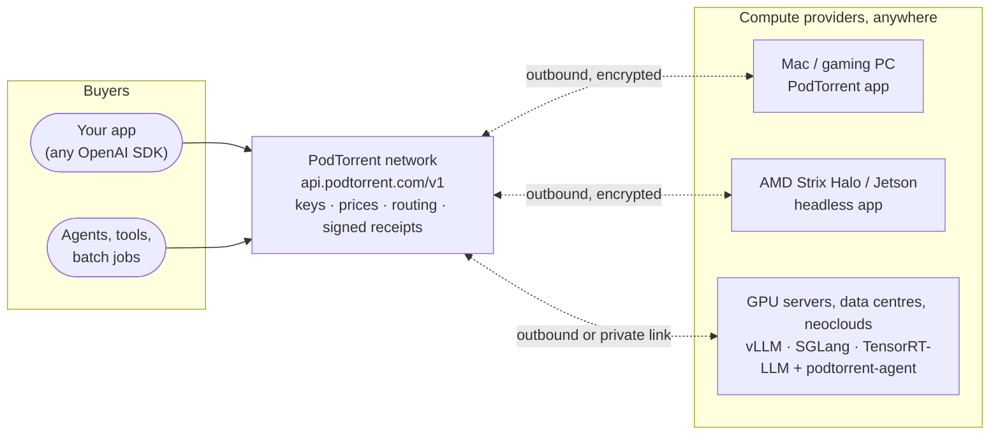
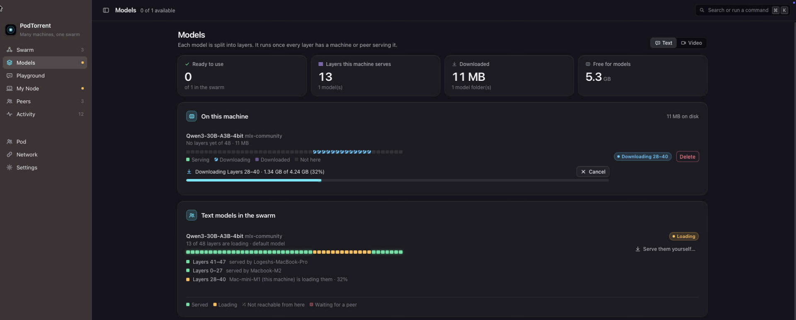
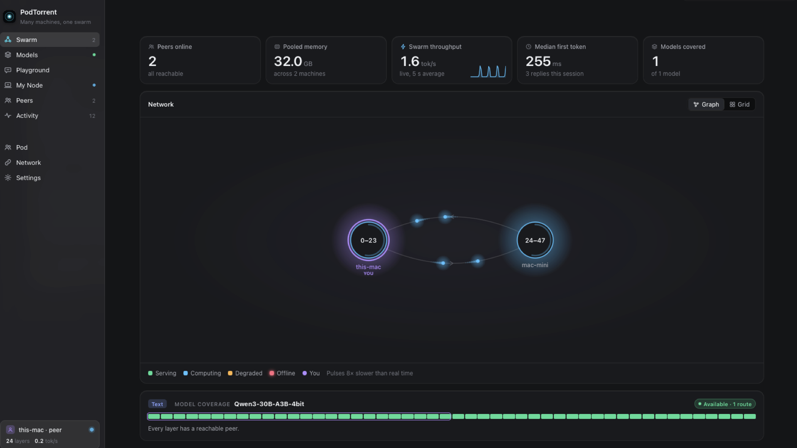
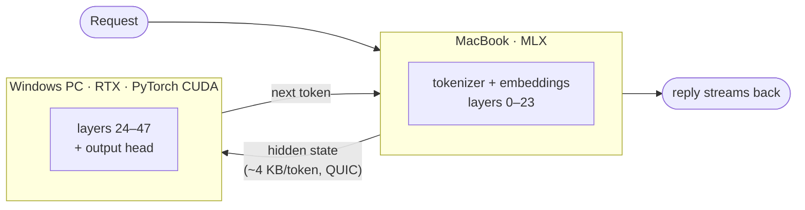
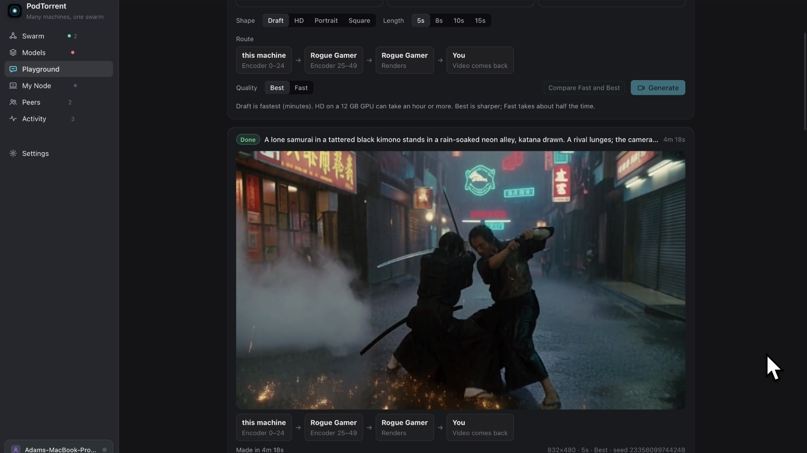
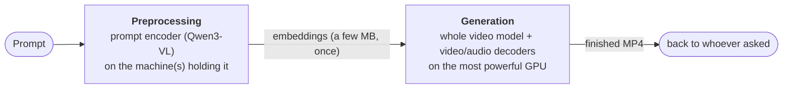
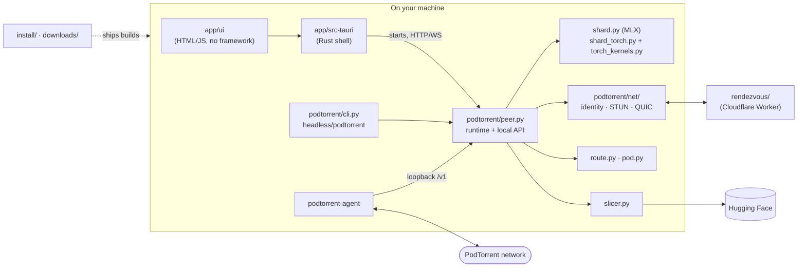

<div align="center">


# PodTorrent

### Local compute. Global inference.

Put any machine on a global, OpenAI-compatible inference market: a Mac on your desk, a gaming PC, a rack in a garage, a GPU hall the size of a bitcoin mine, or a whole neocloud. Set your price. Serve requests from anywhere in the world. Get paid for every token.

[](LICENSE)

[](.github/workflows/linux.yml)
[](.github/workflows/windows.yml)
[](.github/workflows/linux-amd.yml)
[](.github/workflows/linux-jetson.yml)

[Provide compute](#provide-compute) · [Buy inference](#buy-inference) · [Trust and sovereignty](#trust-privacy-and-sovereignty) · [Install](#install) · [Bigger models](#bigger-models-machines-that-team-up) · [Audit the code](#auditing-the-codebase) · [Docs](https://docs.podtorrent.com)

</div>

## Why PodTorrent

AI inference today runs in a handful of data centres. Meanwhile, capable hardware sits idle everywhere: Apple Silicon Macs, gaming GPUs, AMD AI workstations, edge boxes, and spare capacity in GPU clouds. PodTorrent connects that supply to anyone who needs tokens.

- **For compute providers.** Install the app (or run the agent next to your existing engine), pick the models you serve and the price you charge, and join. No open ports: your machine dials out. You're paid only for requests that both sides have signed for.
- **For developers.** It's the OpenAI API. Change the base URL and the key, and any OpenAI SDK works. Cap what you pay per request, or ask for verified nodes only.
- **For enterprises.** The code that runs on a node is open source (Apache-2.0) and auditable. The gateway never stores prompts or answers. And you can run the whole stack privately on your own machines, in your own jurisdiction ([sovereignty](#trust-privacy-and-sovereignty)).



## Provide compute

Pick the path that fits what you have:

| You have | Use | What it does |
| --- | --- | --- |
| A Mac, gaming PC, AMD Ryzen AI Max box or NVIDIA Jetson | **The PodTorrent app (this repo)** | Downloads the model, runs it on your GPU, and connects it to the network. Nothing else to install. |
| GPU servers already running vLLM, SGLang, TensorRT-LLM, llama.cpp or Ollama | **[podtorrent-agent](https://github.com/podtorrent/podtorrent-agent)** | A ~6 MB Go binary or container that sits next to your engine and connects it. Your serving stack stays as it is. One agent per engine, as many as you run. |
| Several machines, and a model too big for any one of them | **The PodTorrent app, in a pod** | Splits the model by layer across your machines so together they serve it as one node. [More](#bigger-models-machines-that-team-up). |

**With the app:**

1. **Install** it ([below](#install)) and start your node.
2. **Choose a model** in **Models**. The app shows what fits on this machine and downloads it.
3. **Register** your node at [podtorrent.com/register-node](https://podtorrent.com/register-node). You'll get access to the operator dashboard, where you create a node token.
4. In **Settings → PodTorrent Network**, enter your node id and token, set your **input and output price** (USD per million tokens, or 0 to serve free), and click **Join Network**.

Your machine becomes a node: it serves the models it fully covers, and the operator dashboard at [dashboard.podtorrent.com](https://dashboard.podtorrent.com/operator) shows requests, tokens per second and earnings. Headless machines do the same with `podtorrent setup` and `podtorrent join` ([guide](#headless-linux-amd-ryzen-ai-max-and-nvidia-jetson)).

**Scale.** One operator can run many nodes: a single laptop, a rack, or racks across sites. Each node declares how many requests it takes at once (`slots`), which work it wants (interactive, batch or both), and its prices. Large fleets usually run the agent on each engine; see its [operator guide](https://github.com/podtorrent/podtorrent-agent).

### Pricing is a market

Providers set their own prices: input, cached input and output per million tokens, with a separate batch price if they like, or free. Buyers can cap what they'll pay per request. The network sends each request to an eligible node with free capacity, preferring lower prices and verified nodes, and publishes live price ranges per model at `GET /v1/network/offers`. Details: [prices and tiers](https://docs.podtorrent.com/running-a-node/prices-and-tiers).

## Buy inference

The network speaks the OpenAI API. Point any OpenAI SDK at it:

```python
from openai import OpenAI

client = OpenAI(base_url="https://api.podtorrent.com/v1", api_key="pt_...")
reply = client.chat.completions.create(
    model="mlx-community/Qwen3-30B-A3B-4bit",
    messages=[{"role": "user", "content": "Hello from the swarm"}],
)
print(reply.choices[0].message.content)
```

- `GET /v1/models` lists what connected nodes serve right now; `GET /v1/network/offers` shows each model's price range, capacity and verified nodes.
- Streaming works, and `usage` is always reported. Each response names the node that served it (`X-PodTorrent-Node`).
- Ask for a price ceiling or verified nodes only per request. See [using the API](https://docs.podtorrent.com/using-the-api/tiers-and-prices).

Getting an API key: see the [quickstart](https://docs.podtorrent.com/getting-started/quickstart).

## Trust, privacy and sovereignty

PodTorrent is built so a careful buyer, a bank's risk team for example, can see exactly where data goes and choose how much of the network to trust.

| | |
| --- | --- |
| **Open source** | Everything that runs on a provider's machine (this app, the headless build, the agent, the installers, the rendezvous) is Apache-2.0 and in public repositories. Windows and Linux builds come from public CI; every download has a SHA-256 checksum. |
| **No content stored by the network** | The gateway passes prompts and answers through and never stores them. Usage records hold token counts and timings only. |
| **Signed receipts** | Every request is signed by both the network and the node (Ed25519). Providers are paid only when both sides agree. |
| **Verified nodes** | Nodes are checked against reference outputs per model. Buyers can require verified nodes only. |
| **Encrypted links** | TLS everywhere. Nodes dial out over WSS; inbound nodes can require mutual TLS, a Cloudflare Tunnel or your own WireGuard network. |
| **Your own nodes only** | An operator can keep its nodes for its own client keys, so its traffic never reaches anyone else's hardware. |

**What a provider can see.** The node that serves a request sees its prompt and answer, as with any inference provider. When a model is split across machines, every machine on the route sees intermediate state. Send sensitive data only to nodes you trust: verified nodes, your own nodes, or your own private network. Confidential-computing nodes are on the roadmap. Details: [privacy](https://docs.podtorrent.com/concepts/privacy).

**Sovereign deployments.** Because the node side is open source, an organisation can run PodTorrent entirely on its own terms: its own machines, its own rendezvous server ([`rendezvous/`](rendezvous/)), its own private pods, in its own jurisdiction, with nothing leaving its network. [CONTRIBUTING.md](CONTRIBUTING.md) shows how to stand up your own servers.

## Supported platforms

| Machine | GPU | Engine | How you run it | Download name |
| --- | --- | --- | --- | --- |
| **Mac**, Apple Silicon (M1 or newer) | Apple GPU | MLX | Desktop app (`.dmg`) **or** headless over SSH | `macos-arm64`, `macos-arm64-headless` |
| **Windows** x64 | NVIDIA (driver 570+, RTX 50-series included) | PyTorch, CUDA 12.8 | Desktop app (`.exe` installer) | `windows-x64-cuda` |
| **Linux** x64 | NVIDIA (driver 570+) | PyTorch, CUDA 12.8 | Desktop app (AppImage) | `linux-x64-cuda` |
| **Linux** x64, AMD Ryzen AI Max (Strix Halo, gfx1151) | Radeon 8050S / 8060S / 8065S | PyTorch, ROCm | Desktop app (AppImage) **or** headless over SSH | `linux-x64-rocm`, `linux-x64-rocm-headless` |
| **NVIDIA Jetson** AGX Orin (ARM64, JetPack 6 or 7) | Integrated Ampere | PyTorch, CUDA | Headless over SSH | `linux-arm64-jetson-headless` |
| **GPU servers** running vLLM, SGLang, TensorRT-LLM, llama.cpp, Ollama | Any | Your engine | [podtorrent-agent](https://github.com/podtorrent/podtorrent-agent) | — |
| **iPhone / iPad** | — | — | In progress: the pod and rendezvous core ([`ios/`](ios/README.md)) | — |

## Install

The installers pick the right build for your machine, check its SHA-256, need no root or admin, and update in place when run again.

```bash
# macOS and Linux
curl -fsSL https://podtorrent.com/install.sh | sh
curl -fsSL https://podtorrent.com/install.sh | sh -s -- --headless     # force headless (or --desktop, --build NAME)
```

```powershell
# Windows
irm https://podtorrent.com/install.ps1 | iex
```

| Build | Installs to | Start it with |
| --- | --- | --- |
| `macos-arm64` | `/Applications/PodTorrent.app` (or `~/Applications`) | `open -a PodTorrent` |
| `windows-x64-cuda` | `%LOCALAPPDATA%\PodTorrent` (per user) | Start menu |
| `linux-x64-cuda`, `linux-x64-rocm` | `~/.local/share/podtorrent/desktop/PodTorrent.AppImage` + menu entry | `podtorrent-desktop` |
| `linux-x64-rocm-headless`, `linux-arm64-jetson-headless`, `macos-arm64-headless` | `~/.local/share/podtorrent/app` | `podtorrent` |

Prefer a direct download? [podtorrent.com/download](https://podtorrent.com/download) lists every build; `https://podtorrent.com/download/<name>` always serves the latest, and `/download/<name>.sha256` its checksum. Every name, URL and installer rule: [docs/DOWNLOADS.md](docs/DOWNLOADS.md).

**First launch** installs the app's Python environment into `~/.podtorrent` (one time, needs internet). On Windows and Linux that includes PyTorch for your GPU, a few GB, so it takes several minutes.

**The builds are unsigned for now:**

- **macOS:** right-click the app → **Open** the first time (or `xattr -dr com.apple.quarantine /Applications/PodTorrent.app`).
- **Windows:** SmartScreen shows a warning; click **More info → Run anyway**. Click **Allow** when Windows Firewall asks, or other machines can't reach the PC over UDP.

## The desktop app

<p align="center">
  
  <br><sub><b>Models.</b> Three machines covering Qwen3-30B-A3B between them: two serve layers 0–27 and 41–47, and this Mac mini downloads layers 28–40 to fill the gap.</sub>
</p>

Open the app, give your machine a name, and click **Start My Node**.

| View | Shows |
| --- | --- |
| **Models** | **Text:** models on this machine and in your swarm, coverage per layer, Hugging Face search, what fits here. **Video:** this machine's video roles |
| **Playground** | **Text:** chat with any model you can reach, with per-token timing. **Video:** write a prompt, watch the job run, play the clip |
| **Swarm** | The machines you serve with, who holds which layers of each model, and any gaps |
| **Peers** | Every peer online, how it's reached (direct or relayed), with round-trip time |
| **Activity** | Peers joining and leaving, layer assignments, replies |
| **My Node** | This machine: slices, memory, tokens/s; also its **Pod** |
| **Settings** | Name, data folder, **PodTorrent Network**: node id, token, prices, join or leave |

Closing the window keeps the node running in the tray / menu bar; ⌘Q (Quit) stops it. ⌘K opens the command palette. Engine output goes to `~/.podtorrent/engine.log`.

### Supported models

The app's engine runs MLX models from Hugging Face in the **`qwen3_moe`** and **`qwen3_5_moe`** families, 4-bit or 8-bit: Qwen3-30B-A3B (and its 2507 and Coder versions), Qwen3.5-35B-A3B, Qwen3.5-122B-A10B, Qwen3-235B-A22B. The default is `mlx-community/Qwen3-30B-A3B-4bit`. For any other model, run your own engine with [podtorrent-agent](https://github.com/podtorrent/podtorrent-agent). Adding a family to the app's engine: [docs/ENGINE.md](docs/ENGINE.md).

**Speed, measured:** Qwen3-30B-A3B-4bit split across an AMD Strix Halo and a Jetson AGX Orin runs at **35 tokens/s** end to end, with the fused GPU kernels and CUDA graphs on.

## Headless Linux (AMD Ryzen AI Max and NVIDIA Jetson)

For a machine you reach over SSH, with no display:

- **AMD Ryzen AI Max / Strix Halo** (Radeon 8050S/8060S/8065S, gfx1151): Linux kernel 6.14+ with `amdgpu`, your user in the `video` and `render` groups, and about 25 GB free disk for ROCm PyTorch.
- **NVIDIA Jetson AGX Orin:** JetPack 6 or 7 (L4T R36, R38/R39), your user in the `video` and `render` groups (without `render`, CUDA fails with error 801 on JetPack 7), and about 10 GB free disk. For the most GPU speed: `sudo nvpmodel -m 0 && sudo jetson_clocks`.

`podtorrent setup` checks all of this first and says exactly how to fix what's missing.

```bash
curl -fsSL https://podtorrent.com/install.sh | sh     # picks the AMD or Jetson build
podtorrent setup
```

`install.sh` (`install/install.sh`, served by the downloads Worker) installs the headless build in `~/.local/share/podtorrent` and puts `podtorrent` in `~/.local/bin`; running it again updates. For a manual download: `wget https://podtorrent.com/download/linux-x64-rocm-headless.tar.gz` (its checksum is at `/download/linux-x64-rocm-headless.sha256`).

`setup` walks through the first run: it checks the machine, installs PyTorch for the GPU and tests it, asks for the name other peers see, starts the peer as a systemd user service, suggests a model and the layers this machine should serve (the swarm's missing layers, sized to free GPU memory), downloads them, and offers to join the PodTorrent network (production; `--network staging` for staging). Run it again any time to add a slice. Scripted install:

```bash
podtorrent setup --yes --name halo-1 --model OWNER/NAME --serve 0:24 --no-join
```

| Command | What it does |
| --- | --- |
| `podtorrent top` | Live view: what this machine serves, tokens/s, each model's coverage and route, every peer (Ctrl-C quits) |
| `podtorrent status` | The same, once (`--json` for scripts and monitoring) |
| `podtorrent join [--price-in N --price-out N]` / `leave` | Join or leave the PodTorrent network with a node token, at your prices |
| `podtorrent doctor` | Checks everything and writes one file to send to support (no node token in it) |
| `podtorrent peer` | Run the peer in the foreground |
| `podtorrent install-service` / `uninstall-service` | Run it as a systemd user service (logs: `journalctl --user -u podtorrent -f`) |

`sudo loginctl enable-linger $USER` keeps the service running after logout and starts it at boot. For the web dashboard, forward the port from your own computer and open http://127.0.0.1:27183:

```bash
ssh -L 27183:127.0.0.1:27183 user@halo-box
```

The full guide for the person running the machine, including uninstalling, is [headless/README.md](headless/README.md); it ships in the tarball.

### Headless Macs over SSH

An Apple Silicon Mac you reach over SSH (a Mac mini or Mac Studio with no one at the screen) runs the same launcher and commands: `install.sh` run over SSH (or with `--headless`) installs `macos-arm64-headless`. It runs on MLX instead of PyTorch (macOS 14+, about 1 GB on first run), keeps the Mac awake while the peer runs, and runs as a launchd job (`com.podtorrent.peer`) instead of systemd: a LaunchAgent by default, or with `podtorrent install-service --at-boot` a LaunchDaemon that runs as your user from boot with nobody logged in (asks for sudo once). Logs: `tail -f ~/.podtorrent/service.log`. `setup` also warns when FileVault is on (a restart waits for someone to unlock it) and when the Mac stays off after a power cut (`sudo pmset -a autorestart 1`). `headless/package.sh` builds it with `PODTORRENT_PLATFORM=macos`; CI: [macos-headless.yml](.github/workflows/macos-headless.yml).

## Bigger models: machines that team up

Most providers serve a model from one machine. When a model is too big for any one machine you own, PodTorrent can split it **by layer range**: one machine runs layers 0–23, another runs 24–47, and the hidden state (a few KB per token) hops between them. Macs (MLX) and PCs (PyTorch) can sit in the same chain, because both run the same MLX 4-bit files and round the same way.

<p align="center">
  
  <br><sub><b>Swarm.</b> Who holds which layers, with hidden states moving between machines, and the model's per-layer coverage below.</sub>
</p>



1. **Download.** A machine that serves layers `[24, 48)` downloads only those tensors (`podtorrent/slicer.py`). Before downloading, the slice is checked against the machine's GPU memory budget and refused if it won't fit.
2. **Discover.** Each machine registers with a small rendezvous service and learns who else is online and what they serve.
3. **Connect.** Machines punch through NAT and open QUIC connections directly. If hole punching fails (a symmetric NAT, say), the QUIC connection is relayed through the rendezvous instead; either way it's encrypted end to end and both ends prove their identities.
4. **Route.** For each model, `podtorrent/route.py` picks a chain of reachable machines that covers every layer.
5. **Serve.** The machine at the front of the chain (the **head**) runs the tokenizer and embeddings, and serves the model on the network as one node. The hidden state travels through each slice in order, and tokens stream back.

**Pods** decide who serves with whom. Keep a chain to your own machines in a **private pod** (you invite members and fix the layer split), let the matchmaker group you with strangers in a **public pod**, or run **alone**, holding every layer yourself. A machine is in at most one pod at a time.

```bash
uv run podtorrent pod new home                                  # on the owner machine (--alone: a pod of one)
uv run podtorrent pod show                                      # on each member: its id and pubkey
uv run podtorrent pod add <pubkey> air                          # owner: add a member by pubkey, with a name
uv run podtorrent pod plan mlx-community/Qwen3-30B-A3B-4bit 48 studio:0:24 air:24:48
uv run podtorrent pod export > home.json                        # copy to members, then: pod import home.json
```

Design: [docs/P2P_PLAN.md](docs/P2P_PLAN.md) (networking), [docs/PODS_PLAN.md](docs/PODS_PLAN.md) (pods), [docs/ENGINE.md](docs/ENGINE.md) (the engine).

## Video generation

The app also makes short videos with sound from a text prompt, using [MiniMax-H3](https://huggingface.co/MiniMaxAI/MiniMax-H3).

<p align="center">
  
  <br><sub><b>Playground → Video.</b> A 5-second 832×480 clip, made in 4 min 18 s: a MacBook encoded the first half of the prompt, a gaming PC encoded the rest and rendered the video.</sub>
</p>

The video model isn't split by layer; the job is split by stage:



- **Rendering** needs an NVIDIA GPU with at least 12 GB of memory and plenty of system RAM. The engine installs and runs a pinned, headless ComfyUI for it.
- **Preprocessing** runs on another machine, Macs included.
- **Use it** in the app (**Models → Video** to pick roles, **Playground → Video** to make a clip) or the CLI (`podtorrent serve h3-video`, `podtorrent serve h3-encoder:missing`, `podtorrent video`). Clips take a few minutes; the app notifies you when one is ready. Video nodes can price per second of video on the network.

Design and decisions: [docs/VIDEO_PLAN.md](docs/VIDEO_PLAN.md).

## Run from source

Works on macOS (Apple Silicon), Linux and Windows. `uv` installs the right engine for the platform: MLX on Apple Silicon, CUDA 12.8 PyTorch on Windows and Linux.

```bash
brew install uv            # or: curl -LsSf https://astral.sh/uv/install.sh | sh
git clone https://github.com/podtorrent/podtorrent-desktop podtorrent && cd podtorrent
uv sync
uv run podtorrent peer --open   # local API + dashboard on http://127.0.0.1:27183
```

Optional but recommended: a Hugging Face token for faster downloads (`huggingface-cli login`, or `export HF_TOKEN=...`).

### Servers (endpoints.json)

No server address is in this repository. A peer finds others through a **rendezvous** you run (`rendezvous/`, a Cloudflare Worker), named in `podtorrent/endpoints.json`, which is gitignored. Official builds get theirs from CI. From a checkout, deploy your own and point the file at it:

```bash
cp endpoints.example.json podtorrent/endpoints.json   # then edit it; CONTRIBUTING.md has the steps
```

Without the file a peer runs alone: it serves its slice and chats locally, with no swarm. For a quick local test, `npx wrangler dev` in `rendezvous/` and `PODTORRENT_RENDEZVOUS=ws://localhost:8787`.

### Running a peer

```bash
uv run podtorrent peer                  # serve nothing yet; local API + dashboard on http://127.0.0.1:27183
uv run podtorrent peer --serve 0:48     # serve a whole model, or a layer range (remembered in ~/.podtorrent/config.json)
```

A peer can serve several slices, of several models, at once. While it runs:

```bash
uv run podtorrent serve 0:12                                   # another slice of the default model
uv run podtorrent serve mlx-community/Qwen3-30B-A3B-4bit:24:48 --peer mac-b   # ask a connected peer instead
uv run podtorrent unserve 0:12                                 # or `unserve <model>` for all its slices
uv run podtorrent models                                       # per-layer coverage, gaps and route for each model
uv run podtorrent swarm --watch                                # every online peer, and how it's reached (with RTT)
```

Before downloading, a slice is checked against this machine's GPU memory budget (on a Mac, macOS's recommended working set, about 75% of RAM) and refused if it won't fit. Cap it with `PODTORRENT_MEM_BUDGET_GB`.

### Platform tips

- **Mac:** keep it awake while serving with `caffeinate -dis &`. A 16 GB Mac may need a higher GPU wired-memory limit for an ~8.5 GB slice plus KV cache:
  ```bash
  sudo sysctl iogpu.wired_limit_mb=13000   # resets on reboot; note the value you use
  ```
  Peers in one chain should run the same MLX version: `uv run python -c "import mlx.core as mx; print(mx.__version__)"`.
- **Windows / Linux with NVIDIA:** driver 570 or newer (needed by CUDA 12.8). If the firewall is on, allow UDP for the peer, or pin the port with `PODTORRENT_UDP_PORT` and open just that one.
- **AMD Strix Halo and Jetson from source:** the CUDA wheel won't drive these GPUs; use the headless build, which installs the right PyTorch on first run.

### CLI reference

| Command | What it does |
| --- | --- |
| `peer` | Run this machine's peer: serve slices, request completions, local API |
| `serve [MODEL:]LO:HI [--peer NAME]` | Ask the running peer (or a connected one) to serve another slice; waits until loaded |
| `unserve [MODEL:]LO:HI \| MODEL` | Stop serving a slice, or every slice of a model |
| `serve h3-encoder:LO:HI \| h3-encoder:missing \| h3-video` | Take a video role: prompt-encoder layers, or rendering |
| `models` | Coverage, gaps and route of every model the swarm serves |
| `swarm [--watch]` | Every PodTorrent peer online right now |
| `pod show \| new \| add \| remove \| plan \| export \| import \| leave` | Manage this machine's pod by hand |
| `setup` | Pick a model and layers for this machine, then download and serve them |
| `top`, `status [--json]` | Live (or one-shot) view of this machine and the swarm |
| `video` | Video roles of every machine and the route a video job would take |
| `download host\|worker --split N` | Download one side of a two-machine split without running a peer (from the pre-P2P version) |

| Command | Flag | Default |
| --- | --- | --- |
| `peer` | `--model` | `mlx-community/Qwen3-30B-A3B-4bit` |
| `peer` | `--model-dir` | `~/.podtorrent/models/<model>` |
| `peer` | `--layers` | from the model's config (48) |
| `peer` | `--serve [MODEL:]LO:HI` (repeatable) | the slices served last time, else nothing |
| `peer` | `--port`, `--open` | 27183 (or `PODTORRENT_PORT`), don't open a browser |

### Environment variables

| Variable | Effect |
| --- | --- |
| `PODTORRENT_HOME` | Data folder (default `~/.podtorrent`): models, config, identity, logs |
| `PODTORRENT_NAME` | The name other peers see |
| `PODTORRENT_PORT` | Local API port (default 27183, 127.0.0.1 only) |
| `PODTORRENT_UDP_PORT` | Pin the QUIC port (random by default) |
| `PODTORRENT_MEM_BUDGET_GB` | Cap the GPU memory PodTorrent plans to use |
| `PODTORRENT_RENDEZVOUS` | Override the rendezvous URL, e.g. `ws://localhost:8787` |
| `PODTORRENT_BACKEND` | `torch` forces PyTorch on a Mac (parity tests) |
| `PODTORRENT_DEVICE` | PyTorch device (default `cuda` if available, else `cpu`) |
| `PODTORRENT_TORCH_FAST=0` | Use the PyTorch reference path instead of the fused GPU kernels |
| `PODTORRENT_CUDA_GRAPHS=0` | Keep the fused kernels but don't replay decode as CUDA graphs |
| `HF_TOKEN` | Hugging Face token for faster downloads |

### Local API

The peer's API binds to **127.0.0.1 only**. The app, the bundled agent and your scripts use it.

- `GET /v1/models`, `POST /v1/chat/completions`: OpenAI-compatible, over this machine's route. Generation is greedy; sampling parameters are accepted and ignored.
- `/api/*`: the peer's own API (`/api/models`, `/api/swarm`, `/api/serve`, `/api/unserve`, `/api/chat`, `/api/complete`, `/api/pod/*`, …) and a `/ws` event stream. See the routes at the end of [`podtorrent/peer.py`](podtorrent/peer.py).

```bash
curl http://127.0.0.1:27183/v1/chat/completions -H 'content-type: application/json' \
  -d '{"model": "mlx-community/Qwen3-30B-A3B-4bit", "messages": [{"role": "user", "content": "Hello"}]}'
```

### How the app connects to the network

The app bundles [podtorrent-agent](https://github.com/podtorrent/podtorrent-agent). When you join, the agent dials the network and forwards requests to the peer's loopback `POST /v1/chat/completions` and `GET /v1/models`; the peer runs them on this machine or through its pod's slices.

- The peer writes `network-manifest.json` in the data folder (from `network.json`, which the app saves): one entry per fully covered model, with your prices, `slots: 1`, and the current route as `pipeline`. The agent picks up changes as routes change.
- The node token is saved as `node-token` in the data folder, readable by your user only.
- Building the app stages the agent: `PODTORRENT_AGENT_BIN=/path/to/podtorrent-agent`, or a `podtorrent-agent` checkout next to this repo and Go 1.24+ (`PODTORRENT_GO` to pick a `go`).

## Security

- **The local API listens on 127.0.0.1 only.** Machines in a swarm reach yours over QUIC on a UDP port (random; pin it with `PODTORRENT_UDP_PORT`). QUIC is encrypted and both ends prove their identities; relayed links stay encrypted, and the rendezvous can't read them.
- **The public swarm is open.** Any PodTorrent peer can send work to yours there. Use a private pod to serve only with machines you trust.
- **Your node token** stays in the data folder, readable by your user only; `podtorrent doctor` strips it from its report.
- **No server addresses, keys or tokens are in this repository.**

Report vulnerabilities privately: [SECURITY.md](SECURITY.md).

## Auditing the codebase

Everything that runs on a provider's machine is in this repository, except [podtorrent-agent](https://github.com/podtorrent/podtorrent-agent) (its own public repo; CI downloads a tagged release and checks its SHA-256).



**Suggested reading order:**

1. [`podtorrent/backend.py`](podtorrent/backend.py): how MLX vs PyTorch is chosen.
2. [`podtorrent/slicer.py`](podtorrent/slicer.py): what gets downloaded.
3. [`podtorrent/shard.py`](podtorrent/shard.py) / [`podtorrent/shard_torch.py`](podtorrent/shard_torch.py): running a model. The model's math, unchanged.
4. [`podtorrent/openai_api.py`](podtorrent/openai_api.py): what the network can ask this machine to do, and the manifest it advertises.
5. [`podtorrent/net/`](podtorrent/net/): identity keys, STUN, the rendezvous client, QUIC transport, hole punching and relay. Wire schema: [`podtorrent/pipeline.proto`](podtorrent/pipeline.proto).
6. [`podtorrent/peer.py`](podtorrent/peer.py): the runtime that ties it together, and every local API route.
7. [`rendezvous/src/`](rendezvous/src/): what the rendezvous server knows (the peer registry, rosters, matchmaking).
8. [`install/install.sh`](install/install.sh), [`install/install.ps1`](install/install.ps1): what the one-line installers do.

### Repository layout

| Path | What's there |
| --- | --- |
| `podtorrent/slicer.py` | Downloads only the tensors for a layer range (HTTP range requests) |
| `podtorrent/shard.py` | Loads a layer range into MLX |
| `podtorrent/shard_torch.py`, `podtorrent/torch_kernels.py` | The same layer range in PyTorch, with fused Triton decode kernels on GPUs |
| `podtorrent/backend.py`, `podtorrent/gpu_probe.py` | Engine choice, GPU detection and memory budget |
| `podtorrent/peer.py` | The peer runtime (serving, requesting, local API and event stream) |
| `podtorrent/openai_api.py` | The OpenAI-compatible API and the network manifest |
| `podtorrent/route.py` | Plans which peers run which layers |
| `podtorrent/pod.py`, `podtorrent/pod_cli.py` | Pods: signed rosters, invites, the `pod` command |
| `podtorrent/catalog.py` | Hugging Face search, what fits, local models |
| `podtorrent/cli.py`, `setup_cli.py`, `top_cli.py` | The `podtorrent` command, `setup`, `top` / `status` |
| `podtorrent/net/` | Identity keys, STUN, rendezvous client, QUIC transport, hole punching and relay |
| `podtorrent/video/` | Text-to-video: roles, job routing, the encoder and the ComfyUI render worker |
| `podtorrent/pipeline.proto` | Message schema (regenerate with `uv run python -m grpc_tools.protoc -I podtorrent --python_out=podtorrent podtorrent/pipeline.proto`) |
| `app/` | The Tauri desktop app: `ui/` (front end), `src-tauri/` (Rust), `scripts/` (bundling, version bump, UI preview) |
| `headless/` | The headless launcher (Linux and macOS), packaging, end-to-end tests and its user guide |
| `install/` | The `install.sh` and `install.ps1` installers |
| `rendezvous/` | The Cloudflare Worker that keeps the peer registry and signs public pods |
| `downloads/` | The Cloudflare Worker that serves builds from R2 (`src/builds.json` is the naming standard) |
| `ios/` | The iOS peer's core (Swift package `PodTorrentKit`) |
| `tests/` | Parity, golden-output, routing, pod, API and kernel tests |
| `scripts/bench_torch.py` | PyTorch slice benchmark |
| `spikes/` | Throwaway experiments kept for reference (iOS QUIC, video phase 0) |
| `.github/workflows/` | CI: Windows, Linux (NVIDIA), Linux AMD, Jetson and macOS headless builds |

## Building the desktop app

`app/` is a Tauri 2 app. It bundles `uv`, the Python backend and the agent; on first launch it installs its Python environment into `~/.podtorrent/venv` (needs internet, one time), then runs the engine itself.

Prerequisites: Rust, Node 22, `uv`; on Linux also `libwebkit2gtk-4.1-dev libayatana-appindicator3-dev librsvg2-dev libssl-dev patchelf`.

```bash
cd app && npm install
npm run dev      # dev mode
npm run build    # macOS: app/src-tauri/target/release/bundle/macos/PodTorrent.app (also .dmg)
```

On Windows and Linux the same `npm run build` produces the NSIS `-setup.exe`, or the AppImage and `.deb`; the workflows in [`.github/workflows/`](.github/workflows/) are the reference recipe for each platform. The app talks to the engine over HTTP/WebSocket. UI design: [docs/DESIGN_SYSTEM.md](docs/DESIGN_SYSTEM.md). Preview the UI in a browser: `python3 app/scripts/serve-ui.py`.

## Tests

```bash
uv run --with pytest pytest -q                    # unit tests (add --with torch for the PyTorch parity tests)
uv run --with pytest pytest tests/test_route.py
(cd rendezvous && npm test)                       # rendezvous Worker
(cd ios/PodTorrentKit && ./test.sh)               # iOS core, against tests/pod_vectors.json

# End to end; needs a model dir holding the first 16 layers + embeddings + head
uv run python -m tests.golden <model-dir> --layers 16 --splits 5,10
uv run python -m tests.golden <model-dir> --layers 16 --splits 5,10 --tokens 60 --prompts 6 --failover
uv run python -m tests.multi <model-dir>   # several slices and models per peer, serve/unserve, memory check
```

`tests.golden` starts one peer process per slice (`[0,5)`, `[5,10)`, `[10,16)`), lets them connect over QUIC through the rendezvous, runs 20 prompts through the chain and requires token-exact output versus a single-process reference.

PyTorch backend speed (machines without MLX): `scripts/bench_torch.py <model-dir> --lo 0 --hi 24` prints ms per token for a slice (`--compare` checks the fast path against the reference path, `--synthetic DIR` benchmarks Qwen3.5-122B-sized layers with random weights). On a GPU with Triton, decode runs fused 4-bit kernels replayed as a CUDA graph; `PODTORRENT_TORCH_FAST=0` turns that off, `PODTORRENT_CUDA_GRAPHS=0` keeps the kernels without graphs. `python tests/test_torch_kernels.py` runs the GPU kernel tests on a machine without pytest.

## Documentation

| Where | About |
| --- | --- |
| [docs.podtorrent.com](https://docs.podtorrent.com) | Running a node, using the API, prices, privacy, receipts, the operator dashboard |
| [podtorrent-agent](https://github.com/podtorrent/podtorrent-agent) | Connecting your own engine; the node protocol spec |
| [docs/DOWNLOADS.md](docs/DOWNLOADS.md) | Build names, download URLs, installers |
| [headless/README.md](headless/README.md) | Running a headless machine (AMD, Jetson, Apple Silicon over SSH) |
| [docs/ENGINE.md](docs/ENGINE.md) | The app's engine: why it runs layers itself, fast paths, model families |
| [docs/P2P_PLAN.md](docs/P2P_PLAN.md) | Peer-to-peer design: rendezvous, QUIC, hole punching, routing |
| [docs/PODS_PLAN.md](docs/PODS_PLAN.md) | Pods: private and public chains, rosters, matchmaker |
| [docs/VIDEO_PLAN.md](docs/VIDEO_PLAN.md) | Text-to-video: design and decisions |
| [docs/WINDOWS_PLAN.md](docs/WINDOWS_PLAN.md), [docs/LINUX_PLAN.md](docs/LINUX_PLAN.md) | How the Windows and Linux ports were built |
| [docs/DESIGN_SYSTEM.md](docs/DESIGN_SYSTEM.md) | The app's UI design system |
| [ios/README.md](ios/README.md) | The iOS peer core |
| [docs/DEMO.md](docs/DEMO.md) | The original two-Mac demo (pre-P2P, over Tailscale; kept for history) |

## Contributing and license

Issues and pull requests are welcome, especially for new hardware, new model families and the iOS port. Start with [CONTRIBUTING.md](CONTRIBUTING.md): it covers running your own rendezvous and downloads servers, and the rules for wire formats shared across ports.

Apache-2.0: see [LICENSE](LICENSE) and [NOTICE](NOTICE). The license covers the code, not the PodTorrent name or logo. Security issues: [SECURITY.md](SECURITY.md).
